# Cyber 

A cyberpunk HUD desktop for [Hyprland](https://hypr.land): a [Quickshell](https://quickshell.org)
shell with its own launcher, control panel, capture tools, terminate mode and file previews, a
glass file manager, a CRT-glow terminal, a small Hyprland plugin for the window effects, and a
matching login and lock screen.

[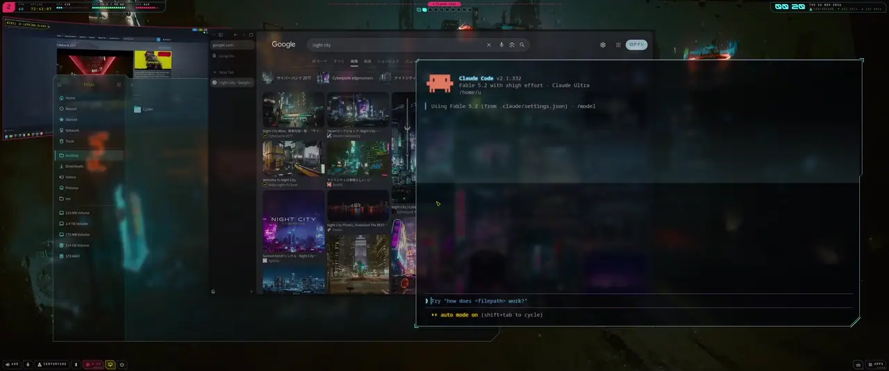](docs/demo.mp4)

## What it looks like

| | |
|---|---|
| 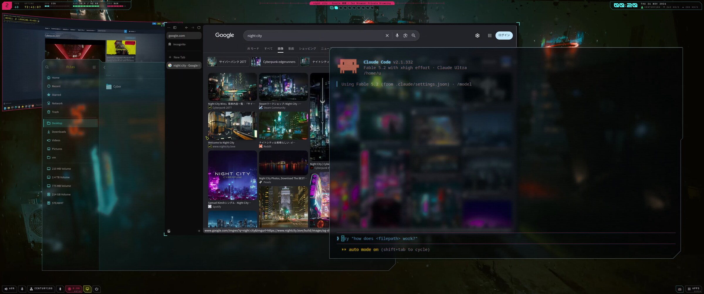 | 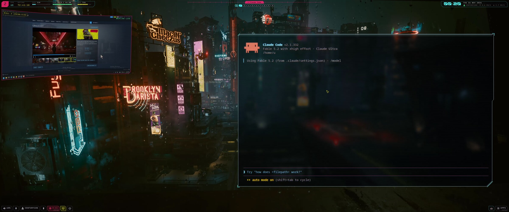 |
| The desktop: HUD bands top and bottom, glass windows over a live wallpaper | The Windows VM as a tilted panel (Looking Glass), the terminal as a HUD panel |
| 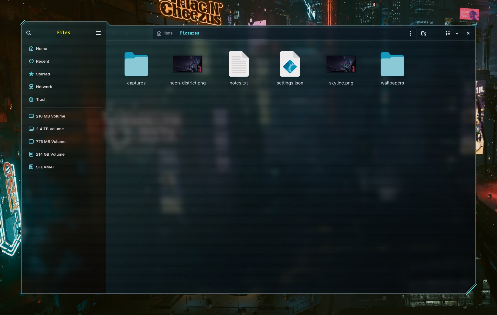 | 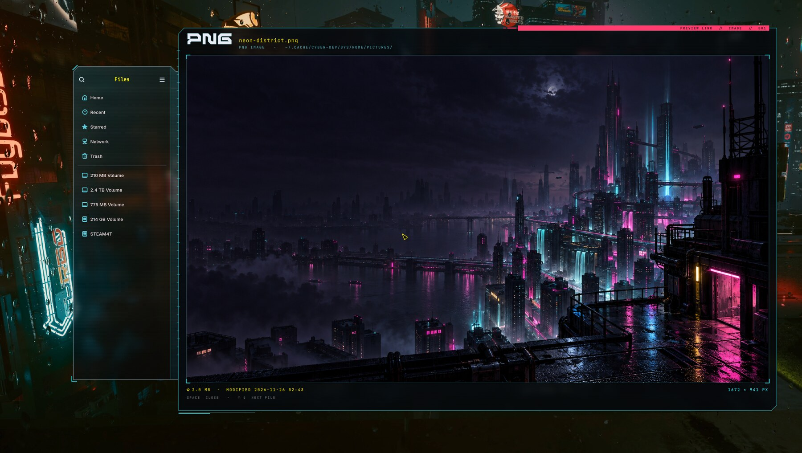 |
| **Files** (GNOME Files / Nautilus) in Cyber's look | **Quick look**: Space on a file in Files (pictures, video, sound, text, PDF) |
| 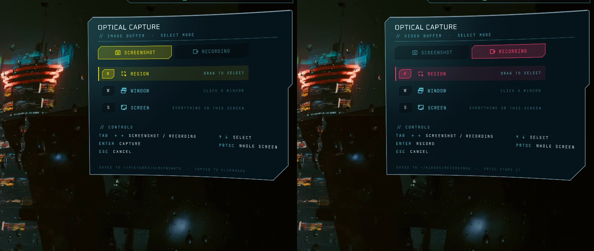 | 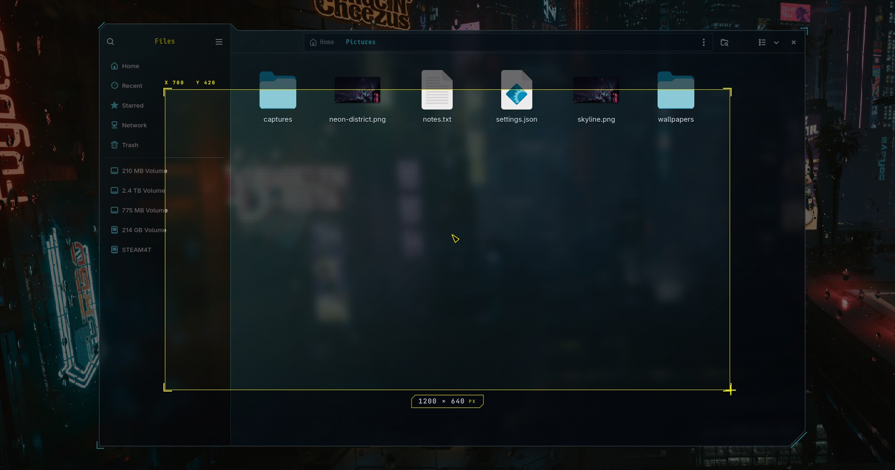 |
| **Capture menu** (PrintScrn): yellow for a screenshot, red for a recording | **Picker**: drag a region or click a window; its size is shown as you go |
| 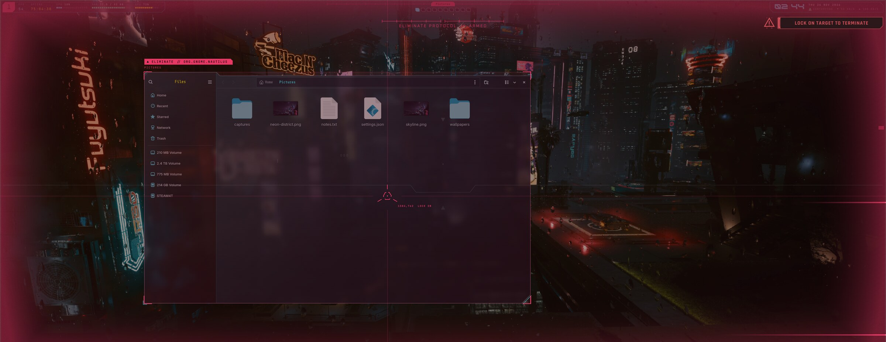 | 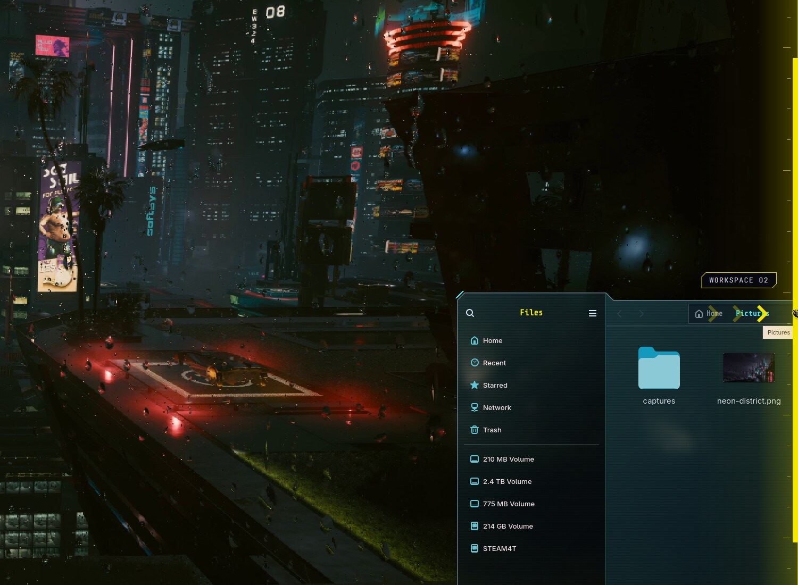 |
| **Terminate mode** (Super+Q): aim at a window, click to close it | **Drag a window to another workspace**: hold it on a screen edge, or press 1 to 0 while dragging |
| 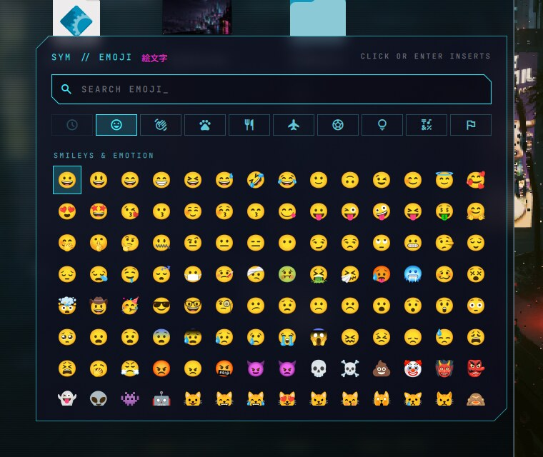 | 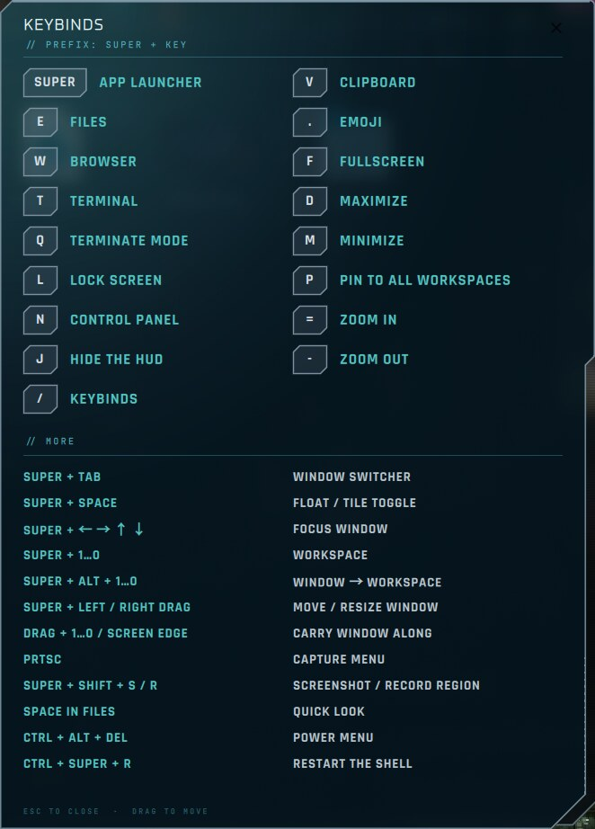 |
| **Emoji** (Super+.): a click types it into the window you were in; Super+V does the same with the clipboard history | **Keybinds** (Super+/ or the `?` button): every key, in a window you can leave open |
| 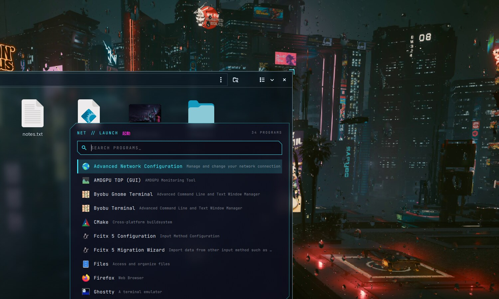 | 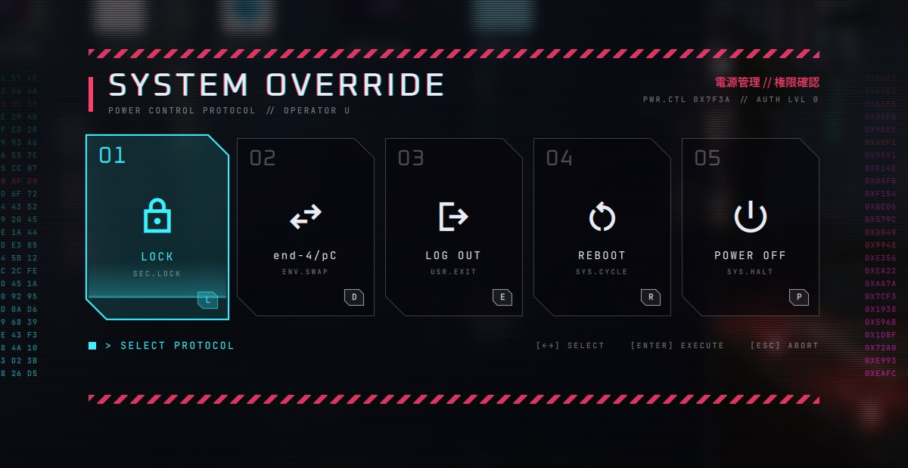 |
| **Launcher** (tap Super) | **Power menu** (Ctrl+Alt+Del) |
| 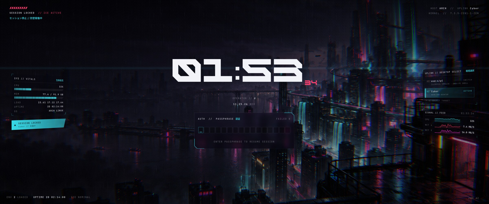 | 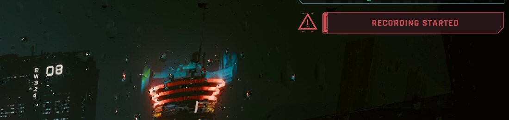 |
| **Lock and login screen** (canvasgreet, in `greeter/`) | The status banner |

## What is in it

- **The shell** (`cyber/`, Quickshell/QML): top and bottom HUD bands (workspaces, clock, CPU / RAM /
  GPU, network, volume, tray), launcher, control panel with notifications, power menu, on-screen
  displays, and the keybinds cheat sheet.
- **Capture** (PrintScrn): screenshots and screen recordings of a region, a window or the whole
  screen. Its own picker dims the screen and shows the size of what you select; a recording is
  announced by a banner that never ends up in the video.
- **Terminate mode** (Super+Q): the screen turns red, a reticle follows the pointer, a click closes
  the window under it.
- **Pickers**: an emoji grid by category (Super+.) and the clipboard history (Super+V); what you
  pick is typed or pasted into the window you were in.
- **Files**: GNOME Files with a glass, folder-tab look; **Space** previews a file as a HUD panel
  (video with a seek bar); right-click > **Copy Path**.
- **Windows**: they float; the focused one gets corner brackets; see-through windows get a blurred
  backdrop that is cheap on a weak GPU; a window you are dragging comes along to another workspace
  (screen edge, or a workspace key). These are a small Hyprland plugin, `cyber/hypr/corners`.
- **Terminal**: Ghostty drawn as a HUD panel with scanlines and a CRT glow (`ghostty/`).
- **Looking Glass**: if you run a Windows VM with [Looking Glass](https://looking-glass.io), its
  window hangs in a corner as a tilted live panel and comes forward when you point at it.
- **Login and lock screen**: `greeter/` (canvasgreet), with a cyberpunk theme.
- **Two desktops**: Cyber sits next to end-4's desktop (illogical-impulse with the end4-pC shell);
  you pick one on the lock screen.

## Keys

Press **Super+/**, or the `?` button at the right end of the bottom band: the keybinds card lists
them all. It is a normal window, so you can drag it aside and leave it open while you try them.

## Requirements

Tested on exactly one machine. Expect to adapt things elsewhere.

- **Arch Linux**, with `yay` (or another AUR helper).
- **Hyprland 0.57** with the Lua configuration. The plugin in `cyber/hypr/corners` is built against
  the installed Hyprland headers and was written for 0.57.2; other versions may need changes.
- **[end-4's dots-hyprland](https://github.com/end-4/dots-hyprland)** (illogical-impulse) as the
  base. Cyber uses its Quickshell, keybinds, fonts and helper scripts, and keeps it as the second
  desktop. `setup.sh` also fetches the [end4-pC](https://github.com/pctrade/end4-pC) shell.
- Packages: `ghostty nautilus grim slurp imagemagick wf-recorder wl-clipboard jq mpv base-devel
  ttf-sharetech-mono-nerd ttf-jetbrains-mono-nerd`, and `mpvpaper` from the AUR (video wallpaper).
- Optional: `nautilus-python` (puts Copy Path directly in the Files right-click menu; without it
  it is under Scripts),
  `looking-glass-client` (the VM panel), a Bluetooth adapter (its button only shows with one).
- One monitor. It was built on 3440×1440 at 60 Hz with an integrated AMD GPU; other sizes work,
  several monitors are untested.

## Install

```sh
# 1. this repo (anywhere; setup.sh links it to ~/.local/share/cyber, the path every config uses)
git clone https://github.com/nodegin/Cyber ~/Desktop/Cyber

# 2. end-4's Hyprland config: interactive, asks for sudo itself
git clone --recurse-submodules https://github.com/end-4/dots-hyprland ~/.cache/dots-hyprland
cd ~/.cache/dots-hyprland && ./setup install

# 3. packages Cyber adds
sudo pacman -S --needed ghostty nautilus grim slurp imagemagick wf-recorder wl-clipboard jq mpv \
    base-devel ttf-sharetech-mono-nerd ttf-jetbrains-mono-nerd
yay -S mpvpaper

# 4. everything else: no sudo, safe to repeat; it ends with a list of anything still missing
~/Desktop/Cyber/setup.sh

# 5. optional: the login and lock screen
sudo ~/.local/share/cyber/greeter/install.sh install
sudo ~/.local/share/cyber/greeter/install.sh enable     # make it the login screen, then reboot
~/.local/share/cyber/lock-mode.sh cyberpunk             # use it as the lock screen too
```

Log into Hyprland and switch to Cyber: `~/.local/share/cyber/desktop.sh apply cyber` (or lock with
Super+L and pick **Cyber** there). `desktop.sh apply end4-pC` goes back.

**Read `setup.sh` before you run it.** It is safe to repeat and needs no sudo, but it is the
author's setup: besides Cyber it also sets up an input method (fcitx5), a personal font rule, zsh
in kitty and turns idle suspend off. Its header lists every step; take out what you do not want.
Run it again after every update of end-4's dots, which overwrite parts of `~/.config`.

## Settings

`cyber/config.json` (read live):

| key | |
|---|---|
| `wallpaper.video` / `.web` / `.image` | the wallpaper: a video (mpvpaper), a web page, or a picture |
| `effects.menus`, `effects.intensity` | the glitch when menus open and close |
| `effects.blurNoise` | the grain in the blur behind glass (0.0117; 0 = none) |
| `capture.scale`, `capture.tilt` | size and tilt of the capture menu |
| `lookingGlass.vm`, `.curve`, `.previewFps` | the VM's name, how much the panel is bent, how often it updates |
| `apps.terminal` | the terminal the shell starts |

Plugin settings go through Hyprland, for example
`hyprctl eval 'hl.config({ plugin = { cybercorners = { drag_ws = 0 } } })'`.
Your own Hyprland settings belong in `~/.config/hypr/custom/*.lua`, outside the `hypr-setup:`
blocks (`setup.sh` rewrites those).

## Troubleshooting

- **Something in the shell looks wrong or is missing:** `qs log -c cyber` shows its errors;
  `Ctrl+Super+R` restarts it.
- **After an update of end-4's dots** things fall back to end-4's defaults: run `setup.sh` again.
- **After a Hyprland update** the plugin rebuilds itself at the next login
  (`~/.cache/hypr-setup/corners-build.log`); until then there are no corner brackets.
- **Stuck on the lock screen:** switch to a text console (Ctrl+Alt+F3), log in, and run
  `sudo ~/.local/share/cyber/recover.sh`.
- **A window covers everything:** `Super+Q`, click it.
- **Anything else: ask Claude.** This desktop was built in conversation with
  [Claude Code](https://claude.com/claude-code). Open this repository in it, say what you see and
  what you expected, and let it read [`docs/NOTES.md`](docs/NOTES.md): the long working notes on
  how each part works, what was measured, and the traps that were found.

## What is where

| folder | |
|---|---|
| `cyber/` | the shell: `shell.qml`, `hud/`, `popups/`, `components/`, `services/`, `shaders/`, `scripts/`, settings in `config.json`; `cyber/hypr/` is its Hyprland side (effects, Looking Glass, the plugin in `corners/`) |
| `alttab/` | the Super+Tab window switcher (it wears the look of whichever desktop is running) |
| `ghostty/`, `kitty/` | the terminal: panel and CRT shader for Ghostty, colours and a find bar for kitty |
| `gtk/` | Cyber's look for GNOME Files, and the Copy path script |
| `greeter/` | canvasgreet: the login and lock screen, with its themes and fonts |
| `cursor/`, `webpaper/` | converts the cursor set; shows a web page as wallpaper or renders it to a video |
| `assets/` | cursor files and wallpapers; [`assets/README.md`](assets/README.md) says where each came from |
| `docs/` | the demo video, screenshots and [`NOTES.md`](docs/NOTES.md) |
| `setup.sh`, `desktop.sh`, `lock-mode.sh`, `recover.sh`, `backup.sh`, `update.sh` | set up / switch desktops / choose the lock screen / get out of a stuck lock / before and after end-4 updates |

## Credits and notices

Cyber stands on other people's work:

- [Hyprland](https://hypr.land) and [Quickshell](https://quickshell.org).
- [end-4/dots-hyprland](https://github.com/end-4/dots-hyprland) and
  [pctrade/end4-pC](https://github.com/pctrade/end4-pC): the base configuration and the second desktop.
- [ARCANGEL0/CyberArch-Shell](https://github.com/ARCANGEL0/CyberArch-Shell): the look of the status
  banner, of terminate mode's guides and reticle, and the layout of the keybinds card follow its
  design. They were redrawn here from its demo videos; none of its code or files are in this repo.
- Fonts in `greeter/themes/cyberpunk/fonts/`: Oxanium, JetBrains Mono and Rajdhani (SIL Open Font
  License, texts next to the files); **Kleemax (demo)**, which its author offers for personal use only.
- `assets/cursor/Yellow/`: the "Yellow" set of the fan-made "Cyberpunk 2077 Cursor Set Pack" by
  NeonKatVT (itch.io), under that pack's own terms.
- `assets/wallpaper/`: a Wallpaper Engine (Steam Workshop) live wallpaper and the video rendered
  from it, and a picture whose source is not known. They belong to their authors.

The bundled artwork is here so the desktop can be recreated from one place. It is **not** offered
under any licence by this repository: personal, non-commercial use only, and if you are an author
and want something removed, open an issue. "Cyberpunk 2077" is a trademark of CD PROJEKT S.A.; this
project is a fan-made desktop theme and is not affiliated with or endorsed by them.
